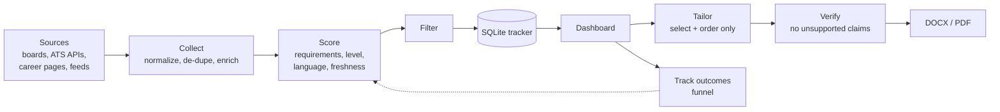

# JobHunter

[](https://github.com/JeremyVieira/JobHunter/actions/workflows/ci.yml)


**A local-first job-search assistant that finds postings, ranks them by how well they match what you can truthfully claim, and prepares application documents that never invent anything.**

Most job tools optimise for volume. JobHunter optimises for *fit and honesty*: every score comes with an explanation, skill gaps are reported instead of hidden, and every generated resume and cover letter is checked against your own master resume before you send it.

## Try it in 60 seconds

No setup, no accounts, no personal data. This opens the full dashboard with a fictional candidate and invented postings:

```bash
git clone https://github.com/JeremyVieira/JobHunter.git
cd JobHunter
python -m venv .venv && source .venv/bin/activate     # Windows: .venv\Scripts\Activate.ps1
python -m pip install -r jobhunter/requirements.txt
python -m jobhunter demo
```

> **Windows tip:** always invoke pip as `python -m pip ...`, never bare `pip`. The `pip.exe`
> launcher hardcodes the venv's original path, so if you ever move/rename the project folder
> (e.g. `JobHunterAI` → `JobHunter`), `pip` breaks with "The system cannot find the file
> specified" while `python -m pip` keeps working. If that happens, recreate the venv:
> `rm -rf .venv` (or `Remove-Item -Recurse .venv`) then repeat the setup above.

Your real data is never touched by demo mode.

## What it does

- **Collects widely.** JobSpy boards, employers' own ATS boards (Greenhouse, Lever, Ashby, Workable, SmartRecruiters, Recruitee, Workday), company career pages (the employer's ATS is detected automatically), The Muse, Adzuna, Jooble and any RSS feed. The same opening on several boards is merged, keeping the employer's own copy. Details: [docs/SOURCES.md](docs/SOURCES.md).
- **Scores on evidence.** Requirement coverage (required vs. nice-to-have skills against what you can truthfully claim), title, years of experience, seniority, language, freshness and location, with a readable "Why this score" for every posting. See [docs/SCORING.md](docs/SCORING.md).
- **Prepares honest documents.** Resumes are *selected and ordered* from your master resume, never rewritten. Cover letters are built from the bullets that match the posting; a company-specific line appears only if you write one. A verifier flags anything unsupported before you send it.
- **Learns from outcomes.** Record screening, interview, rejected or ghosted; the Funnel shows what actually works by score band, source and document language, and your applied/dismissed history gently adjusts future rankings.
- **Stays private.** No account, no telemetry, no third-party AI service. The dashboard binds to localhost, and your files are git-ignored and excluded from built packages.

## Install

**Python 3.10 - 3.12.**

```bash
python -m venv .venv && source .venv/bin/activate     # Windows: .venv\Scripts\Activate.ps1
python -m pip install -r jobhunter/requirements.txt  # or: python -m pip install -e .   (adds the `jobhunter` command)
```

1. Copy `.env.example` to `.env` and fill in your details (see [docs/CONFIGURATION.md](docs/CONFIGURATION.md)).
2. Copy `jobhunter/resume/master_resume.template.txt` to `master_resume.txt` and replace the sample with your real, accurate content. Add `master_resume_fr.txt` for French documents if you need them.
3. Run `python -m jobhunter doctor`. It tells you exactly what is missing and how to fix it.
4. Run `python -m jobhunter run`. The dashboard opens at <http://localhost:8501> immediately and collects jobs in the background; collection then repeats daily.

## Commands

| Command | What it does |
| --- | --- |
| `python -m jobhunter run` | Dashboard plus the daily collection schedule. |
| `python -m jobhunter collect` | Collect and score once, then exit. |
| `python -m jobhunter dashboard` | Dashboard only. |
| `python -m jobhunter demo` | Explore everything with synthetic data. |
| `python -m jobhunter doctor` | Check your setup and what to fix. |
| `python -m jobhunter discover "Name\|careers-url" --count` | Find a company's job-board settings from its careers page. |

## How it works



More detail: [docs/ARCHITECTURE.md](docs/ARCHITECTURE.md).

## Honest by design

- **Resume:** bullets are ranked by how well they evidence the posting, the most relevant projects are chosen from all of yours, and skill groups are reordered. Nothing is reworded or added. Optional `[tags: ...]` on a bullet help ranking and are never rendered; optional `summary_variants.json` lets you swap in your *own* pre-written summaries by role family.
- **Cover letter:** built from matching resume bullets and your education line. If a posting requires something you lack (for example Java) and you have a related tool, the letter says so plainly instead of claiming the skill. Bilingual lines appear only when your resume supports them.
- **Verification:** resume lines must exist in the master resume (skill lists may be reordered, nothing else); numbers and known skills in a letter must appear in your resume or the posting. Anything else lands in `verification_report.txt` and in the dashboard.
- **Scores are not promises.** "Match strength" is a heuristic. Your real response rates are in the Funnel, which only counts outcomes you record.

## Project layout

```text
jobhunter/
  scraper/     sources, ATS adapters, de-duplication, enrichment, discovery
  matching/    skill taxonomy, requirement analysis, seniority
  scoring/     composite scorer and preference learning
  resume/      tailoring, cover letters, fabrication checks, export
  tracker/     SQLite repositories, lifecycle, funnel
  dashboard/   Streamlit UI
  cli.py demo.py doctor.py
docs/          architecture, scoring, configuration
tests/         offline test suite
```

## Development

```bash
python -m pip install -r jobhunter/requirements.txt pytest pytest-cov ruff
python -m ruff check .
python -m pytest tests --cov=jobhunter --cov-fail-under=80
```

CI runs lint, tests with a coverage gate on Python 3.10 - 3.12 (Linux and Windows), builds the wheel (and checks that no private files are packaged), and audits dependencies weekly. See [CONTRIBUTING.md](CONTRIBUTING.md) and [SECURITY.md](SECURITY.md).

## Limitations

- **Single user, run locally.** There are no accounts; a hosted multi-user version is a possible future direction, not something this repository provides.
- **Respect job sites.** JobSpy-backed boards (LinkedIn, Indeed, Glassdoor, ZipRecruiter, Google) are scraped and can block you or change without notice. Check each site's terms, keep volumes modest, and prefer the employer-board and API sources where you can. A source that fails is logged and skipped, not fatal.
- **The skill taxonomy is finite.** Skills it does not know are invisible to coverage scoring unless you add them to `USER_KEYWORDS`.
- **Defaults are Montreal-centred.** The location filter targets Greater Montreal and generic remote postings; adapt `MONTREAL_AREA_TERMS` in `jobhunter/filter.py` for another city.
- **It never submits applications or sends email.** You review every document and apply yourself.

## License

[MIT](LICENSE)
