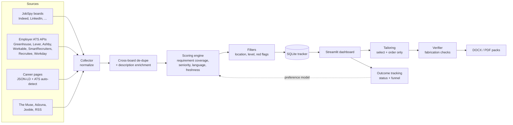

# Architecture

JobHunter is a single-user, local-first application: a collection pipeline, a scoring engine,
a SQLite tracker, a Streamlit dashboard, and a document generator that only ever re-uses
facts from your own master resume.

## Pipeline stages (`jobhunter/app.py`)

| Stage | Responsibility |
| --- | --- |
| `ExtractionStage` | Run every configured scraper (failures are isolated and logged), drop duplicate URLs, collapse the same role across boards, fetch fuller descriptions for short snippets. |
| `ScoringStage` | Score each posting; apply the optional preference model learned from your applied/dismissed history. |
| `FilterStage` | Hard filters (location, seniority/management, agencies and red flags) and a minimum fit score. |
| `PersistenceStage` | Drop roles you already applied to or dismissed (matched by company + title, not just URL), save the best N. |

## Packages

| Path | What lives there |
| --- | --- |
| `scraper/collector.py` | Base scraper, request helpers (retry/backoff, politeness delay), JobSpy, Greenhouse, Lever, career pages, remote boards. |
| `scraper/ats.py` | Ashby, Workable, SmartRecruiters, Recruitee, Workday adapters and `detect_ats`. |
| `scraper/boards.py` | The Muse, Adzuna, Jooble, RSS/Atom. |
| `scraper/dedupe.py`, `enrich.py`, `sources.py`, `discover.py` | Cross-board de-duplication, snippet enrichment, default scraper set, token discovery CLI. |
| `matching/` | Skill taxonomy (`skills.py`), posting analysis and candidate comparison (`requirements.py`), seniority (`levels.py`), resume skill inventory. |
| `scoring/` | `engine.py` (composite scorer) and `feedback.py` (preference learning). |
| `filter.py` | Predicate-based hard filters. |
| `resume/` | `tailoring.py` (rank/select), `letter.py` (cover letters), `verify.py` (fabrication checks), `tailor.py` (parsing, export, packs). |
| `tracker/db.py` | SQLite repositories, application lifecycle, funnel statistics. |
| `dashboard/app.py` | Streamlit UI. |
| `demo.py`, `doctor.py`, `cli.py` | Demo workspace, setup diagnostics, `python -m jobhunter` entry point. |

## Design decisions

- **Whole-word matching everywhere.** Substring checks caused false positives ("excellent" is not
  Excel, "International" is not an internship). All term checks go through `textutils.contains_term`.
- **Evidence over assertion.** A skill counts for you only if it is in your profile keywords or your
  own resume. Gaps are reported, never papered over.
- **Select and order, never rewrite.** Resume tailoring changes the order and choice of existing
  content. `resume/verify.py` checks every generated document against the master resume.
- **Failure isolation.** One broken source never stops a run; it is logged and skipped.
- **Local-first and private.** No account, no telemetry (Streamlit usage stats are disabled), the
  dashboard binds to localhost, and personal files are git-ignored and excluded from built
  image and the built wheel.

## Extending

**Add a job source.** Subclass `BaseScraper`, return dicts produced by `normalize_job(...)`,
register it with `ScraperFactory.register("name", YourScraper)`, and add it to
`build_default_scrapers()` in `scraper/sources.py`. Test it with a fake `_request_get` as in
`tests/test_sources.py`.

**Add a skill.** Add an entry to `SKILLS` in `matching/skills.py` (label, category, aliases).
Aliases are matched as whole words; avoid ambiguous English words ("spring", "express").

**Add a scoring dimension.** Implement `IScoringDimension.evaluate`, add a weight to
`ScoringRulesConfig`, and include it in `CompositeScorer.score_job`.

## Testing

`pytest` runs ~240 tests offline: scrapers use fixture payloads shaped like each vendor's response,
the dashboard is rendered with Streamlit's `AppTest` against the demo workspace, and the
packaging and CLI smoke tests run in CI. Coverage must stay at or above 80%.
