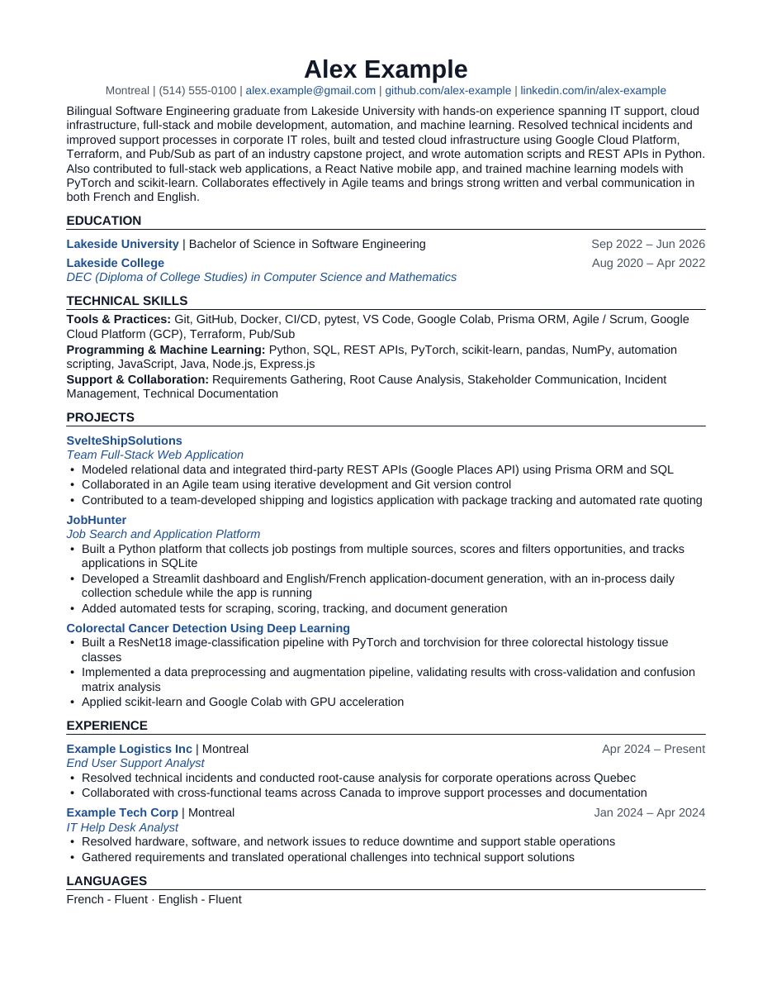

# Resume guide

JobHunter keeps one **master resume** (everything true about you) and produces a tailored,
one-page resume per posting from it. The better the master, the better every output.



*Generated from the fictional demo candidate.*

## What the generated resume looks like

Modelled on resumes professional recruiters write:

- **Header:** your name, then one contact line (city, phone, email, short link labels such as
  `github.com/you`). Street addresses and postal codes are left off by default
  (`RESUME_INCLUDE_STREET_ADDRESS=true` opts in).
- **Summary** with no heading, left-aligned.
- **Entries:** company or project in the accent colour, location after it, dates right-aligned,
  the role on its own italic line, then bullets. A `Project repository: <url>` line becomes a
  short **GitHub** link on the heading instead of using up a bullet.
- **Numbers in bold:** metrics such as `123%`, `$1M+` or `298` are highlighted automatically.
  This is display only: no text is added or changed.
- **One page:** the renderer picks the largest font and spacing that fit (10.5 pt down to 9 pt),
  and adds a third project when there is room for it at 9.5 pt or larger.
- **ATS-friendly:** one column, real text, real bullets, no tables or text boxes in the DOCX,
  tab-aligned dates, document title and author set.

Both formats use the same layout, and the cover letter reuses the same letterhead.

## Section order

`RESUME_LAYOUT` controls it:

| Value | Order |
| --- | --- |
| `auto` (default) | **Recent graduates** (education ended this or last year, or ongoing): Summary, Education, Skills, then Projects and Experience with whichever is stronger *for this posting* first. **Everyone else:** Summary, Experience, Projects, Skills, Education. |
| `experience-first` | Summary, Experience, Projects, Skills, Education |
| `education-first` | Summary, Education, Skills, Projects, Experience |
| `keep` | The order in your master resume |

Only the order changes; no line is rewritten.

## How to write the master resume

```text
Your Name
City | (514) 555-0100 | you@example.com | https://github.com/you | https://linkedin.com/in/you

PROFESSIONAL SUMMARY
Two or three lines: who you are, the role you target, your strongest verifiable proof.

EXPERIENCE

Company, City — Job Title
Apr 2024 - Present
- Action + scope + result, with a real number where you have one [tags: sql, python]
- Another bullet

PROJECTS

Project Name — one-line descriptor
- Project repository: https://github.com/you/project
- What you built and what it achieved
```

- **Headings:** `Company, City — Title` for experience and education, `Name — descriptor` for
  projects. A URL in parentheses after a project name is shown as a link.
- **Dates:** any style; they are shown as `Apr 2024 – Present`.
- **Tags:** a trailing `[tags: ...]` helps ranking and is never printed.
- **Bullets:** start with a verb, state what you did and the result, and keep them under about 25
  words. Use present tense for a current role and past tense for finished ones.
- **Numbers:** only figures you can back up. Never estimate to look better.

## Audit it

```bash
python -m jobhunter resume-audit            # your master resume
python -m jobhunter resume-audit --lang fr  # the French one
```

The audit flags privacy issues (street address), missing results, vague phrases, long bullets,
tense problems, projects without links, skills listed but never shown in a bullet (be ready to
discuss them) and skills shown in bullets but missing from the skills section. For every bullet
with no measurable result it prints a worksheet question such as "How many tickets per week?",
so you can supply a *real* number. It never rewrites your resume and never invents a figure.
